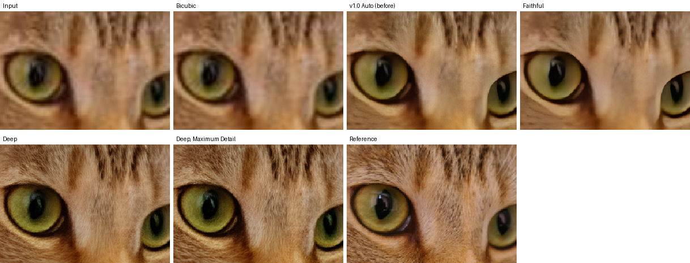
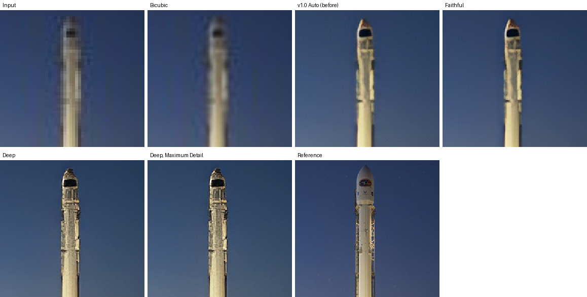
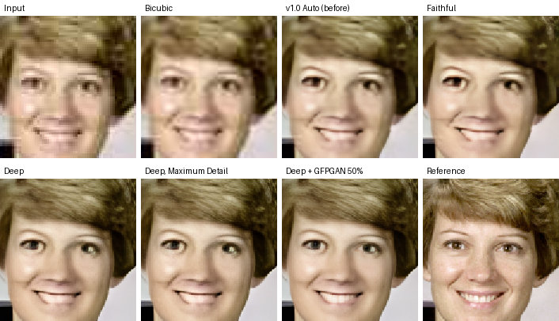

<div align="center">

# Lumen Photo Enhancer

**Turn blurry screenshots, compressed Instagram saves and soft video frames into clearer, higher resolution photos.**
Real-ESRGAN restoration running privately in your browser, with an optional server for generative face restoration.




<sub>A JPEG shared at 40% size and screenshotted on a phone, enhanced 2×. Top row: input, bicubic, v1.0, Faithful. Bottom row: Deep Restoration, Maximum Detail, clean reference.</sub>

</div>

## Why

Screenshots of photos, cropped faces and saved social media images are small, blocky and soft. Lumen restores them with neural networks that run on your own device, and tells you plainly what it did:

* **Real models.** Real-ESRGAN x4plus and Real-ESRGAN general v3 run on your GPU through TensorFlow.js. Each is checked against a NumPy port of the original PyTorch network.
* **Honest output.** Every run lists the models and steps used. Images the models cannot fix, like strong focus or motion blur, are flagged instead of being called fixed.
* **Natural faces.** Faces get the full reconstruction with natural skin grain kept. Generative face restoration is optional, adjustable and runs only on the server.
* **Private.** In the browser, nothing is uploaded.

## What's new in 1.1

Version 1.0 ran real AI inference, but many results looked almost unchanged. An audit found why:

| Root cause in 1.0 | Fix in 1.1 |
|---|---|
| Only the small 1.2 M parameter model ran in the browser | Real-ESRGAN x4plus (16.7 M parameters) now runs in the browser |
| Finishing blended 15 to 35% of plain bicubic pixels back in, more on faces | Bicubic is never blended in. Texture now comes from the weak-denoise model |
| "Face protection" softened faces | Faces get full reconstruction, with only sharpening eased on skin |
| Soft images were enlarged as they were, so the model enlarged the blur | Detail matching processes soft images at their real detail scale first |
| Sharpening was clamped so hard it barely showed | Halo-limited sharpening with a small bounded overshoot |
| 8× (AI 4× plus resampling) was recommended for small images | Recommendations stop at 4× |

See [CHANGELOG.md](CHANGELOG.md) for the full list.

## Benchmark

Six degradation cases built from public domain and CC0 images, each run through every method. The table shows the default Deep Restoration against 1.0 and bicubic. The full table, with every method and timing, is in [docs/benchmark/results.md](docs/benchmark/results.md).

| Case | Method | PSNR | SSIM | Detail | Blur |
|---|---|---|---|---|---|
| Compressed 256 px portrait, 2× | Bicubic | 27.99 | 0.861 | 0.74 | 0.51 |
| | v1.0 | 25.27 | 0.862 | 0.90 | 0.36 |
| | **v1.1 Deep** | 25.24 | 0.859 | **0.94** | **0.33** |
| Slightly blurry photo, 2× | Bicubic | 26.40 | 0.773 | 0.32 | 0.75 |
| | v1.0 | 26.87 | 0.789 | 0.34 | 0.64 |
| | **v1.1 Deep** | **27.40** | **0.813** | **0.45** | **0.45** |
| Low resolution landscape, 4× | Bicubic | 28.16 | 0.819 | 0.25 | 0.57 |
| | v1.0 | 25.71 | 0.822 | 0.57 | 0.27 |
| | **v1.1 Deep** | 24.98 | 0.807 | **0.78** | **0.21** |
| Social media screenshot, 2× | Bicubic | 30.42 | 0.806 | 0.47 | 0.69 |
| | v1.0 | 28.51 | 0.801 | 0.58 | 0.48 |
| | **v1.1 Deep** | 27.08 | 0.766 | **0.86** | **0.39** |
| Noisy, compressed, 2× | Bicubic | 29.36 | 0.804 | 0.60 | 0.34 |
| | v1.0 | 26.82 | 0.868 | 0.67 | 0.27 |
| | **v1.1 Deep** | 26.43 | 0.867 | **0.86** | **0.21** |
| Out of focus (unsupported), 2× | Bicubic | 22.95 | 0.737 | 0.42 | 0.87 |
| | v1.0 | 22.97 | 0.721 | 0.43 | 0.63 |
| | **v1.1 Deep** | 21.21 | 0.719 | 0.80 | 0.40 |

**How to read it**

* **Detail** is edge energy relative to the clean reference (1.0 means reference-level detail). **Blur** is a no-reference blur estimate (lower is sharper). These show the visible gain.
* **PSNR and SSIM** measure pixel fidelity. They reward smooth guesses, so bicubic often scores well while looking blurry. Deep Restoration trades a little PSNR for much more detail; on the blurry photo it wins on both.
* **Face identity** (face-api descriptor distance to the reference, below 0.6 means same person) stayed at 0.39 to 0.41 for every method on the portrait. That is one face only, so treat it as a sanity check, not proof.
* **LPIPS** is supported by `bench/score.py` but needs PyTorch, which was not available when these numbers were made.
* **The out of focus case** is flagged by the analysis as beyond repair. Detail rises, but the added detail is texture, not the real face, and identity distance does not improve.

| | |
|---|---|
|  |  |
| Low resolution landscape, 4× | Compressed portrait, 2×, last tile with GFPGAN at 50% |

Timing above is ONNX Runtime on 2 CPU cores. In the browser the deep model runs on the GPU; expect roughly 10 to 60 seconds for a 512 × 512 photo on a laptop and several minutes on a phone. The fast model is about 15 times quicker.

## Features

| | |
|---|---|
| **Two real models** | Real-ESRGAN x4plus (deep, 33 MB, downloaded on first use) and general v3 (fast, 2.4 MB) on WebGL |
| **Reconstruction control** | Faithful, Balanced (default) or Maximum Detail |
| **Deep Restoration mode** | Maximum clarity for soft, low resolution internet photos |
| **Degradation aware** | Analysis estimates real detail, compression, noise, blur type and content, then picks mode, scale and detail matching |
| **Unsupported blur flagged** | Strong focus or motion blur is reported as beyond repair |
| **Faces** | Detected with alignment points; reconstructed by the main model; optional GFPGAN on the server with adjustable strength |
| **Seamless tiles** | Overlapping tiles blended with linear ramps, matching whole-image inference |
| **Verified output** | Results that do not match the original at its own size are discarded with an error, never exported |
| **Compare properly** | Slider, side by side, single views, 100, 200 and 400% zoom, a Face button that frames each face |
| **Processing report** | Models, every stage, sizes, time and the verification result |
| **Export** | Lossless PNG by default (exactly the previewed pixels), or JPEG and WebP; sizes from full to 1080 px |
| **Works everywhere** | iPhone, iPad and desktop, light and dark mode, reduced motion respected |

## How to use

1. **Open a photo.** Drag it in, paste it, or press **Open**. PNG, JPEG and WebP up to 25 MB and 12 megapixels. For a screenshot, press **Crop** and drag over just the photo.
2. **Read the analysis.** It shows size, compression, noise, how much real detail the image holds, the main issue, and a recommended mode and scale. These are estimates, not measurements.
3. **Pick a mode.** The recommended one is selected for you. Use **Deep Restoration** for soft internet photos, **Portrait** when a face matters, **Natural** for minimal change.
4. **Pick a reconstruction strength.**
   * **Faithful**: fast model, minimal reconstruction.
   * **Balanced**: deep model; the default.
   * **Maximum Detail**: strongest reconstruction. It can add texture that was not in the real scene and cannot recover detail that was never captured.
5. **Press Enhance.** The first deep run downloads 33 MB once. Progress shows real tile counts.
6. **Compare.** Drag the slider, try **Side by side**, use **100%**, **200%** or **400%**, and press **Face** to frame each face.
7. **Tweak.** Colour, sharpness, texture and face controls apply in about a second, because the reconstruction is reused.
8. **Export** as PNG for an exact copy of the preview.
9. **Clear** removes the image and every cached result.

### Tips

* Start from the largest copy of the image you have.
* For faces that look too smooth, raise **Texture preservation**.
* If your GPU runs out of memory, the run fails with a message rather than producing a broken image. Switch to **Faithful** or use 2×.

## What runs where

| Capability | In the browser (and the Claude artifact) | Companion server |
|---|---|---|
| Real-ESRGAN x4plus | Yes, WebGL | Yes, ONNX Runtime (CPU, CUDA, CoreML) |
| Real-ESRGAN general v3 | Yes | Yes |
| Detail matching, analysis, finishing, verification | Yes | Finishing runs in the browser |
| Face detection and alignment points | Yes | Uses the app's landmarks |
| GFPGAN v1.4 face restoration | No, the model is 340 MB | Yes, opt in, 0 to 100% blend |
| Very large images | Up to 34 MP output on desktop, 6 MP on phones (crop for a bigger result) | Configurable |

A Claude artifact cannot call outside servers, so the artifact runs everything in the browser. The server ships its own copy of the same app, which detects `/api/health` and adds a **Server** engine.

## How it works

```
photo
 ├─ validate        file signature, size, dimensions
 ├─ analyse         real detail (round trip test), JPEG grid, noise, blur type, faces with alignment points
 ├─ plan            mode + reconstruction strength + analysis → model, detail scale, mix, sharpening
 ├─ match detail    soft images are processed at their real detail scale (never below the target size)
 ├─ reconstruct     Real-ESRGAN x4plus or general v3, tiled with feathered overlap
 ├─ texture         weak-denoise general v3 output mixed in for natural grain
 ├─ faces           GFPGAN on the server only, aligned from five points, feathered blend
 ├─ finish          bounded white balance and levels, halo-limited sharpening
 ├─ verify          result shrunk to the original size must match it, or the run fails
 └─ preview = export
```

* **Browser models.** Both networks are written directly with TensorFlow.js ops. `tools/convert_weights.py` turns the official `.pth` files into fp16 files using only NumPy; x4plus is split into three 12 MB parts for hosting.
* **Proved, not assumed.** `tests/srvgg.test.ts` checks both browser networks against PyTorch-layout references (max error under 0.002). The server's ONNX graphs pass the same check.
* **Seamless tiles.** Tiles overlap by 16 to 24 input pixels and are blended with linear ramps, plus 16 to 32 pixels of extra context.
* **Server without PyTorch.** Real-ESRGAN graphs are built in memory from the official checkpoints. GFPGAN uses a published ONNX export.

### Model choices

| Model | Decision | Why |
|---|---|---|
| Real-ESRGAN x4plus | Used, browser and server | Clearly sharper than general v3 on real photos; BSD 3-Clause; small enough for WebGL |
| Real-ESRGAN general v3 | Used | Fast; its denoise checkpoints give fine control and a natural texture source |
| SwinIR | Not used | Larger and slower than x4plus for similar results on this kind of input; window attention is impractical in TensorFlow.js |
| Restormer | Not used | Strong deblurring, but the licence is non-commercial and the model is too heavy for browsers |
| NAFNet | Not used | Its deblurring checkpoints target the GoPro motion blur dataset and are only on Google Drive; not verifiable here |
| GFPGAN v1.4 | Used, server, opt in | Apache 2.0; large improvement on small faces; blended so likeness drift stays limited |
| CodeFormer | Not used | Its licence forbids commercial use |
| Diffusion restoration (SUPIR, DiffBIR, StableSR) | Not used | Needs a large GPU and 10 to 60 seconds per image, and invents much more detail. A possible future server option |

## Run it yourself

### Browser app

Requires Node 18 or newer.

```sh
git clone https://github.com/shaaz1000/lumen-photo-enhancer.git
cd lumen-photo-enhancer
npm ci
npm run build        # dist/index.html and dist/models/
npx serve dist
```

### Server on CPU

Requires Python 3.10 or newer.

```sh
npm ci && npm run build
cd backend
pip install -r requirements.txt
sh scripts/download_weights.sh --faces     # checksum verified; drop --faces to skip GFPGAN
cp -r ../dist static
uvicorn app.main:app --port 8000
```

### Server on an NVIDIA GPU

```sh
docker build -f backend/Dockerfile.gpu -t lumen-gpu .
docker run --gpus all -p 8000:8000 lumen-gpu
```

The GPU image uses `onnxruntime-gpu` on CUDA 12. It was written for this release but not run here, because no GPU was available. The CPU image is `backend/Dockerfile`.

### Cost

* **Browser:** free. All compute runs on the visitor's device.
* **Self-hosted server, CPU:** a 2 vCPU machine processes a 512 × 512 deep run in about 30 to 60 seconds.
* **Self-hosted server, GPU:** an entry-level NVIDIA T4 cloud instance typically costs a few hundred US dollars a month if left running; scale to zero when idle. Check your provider's current pricing.
* **Hosted inference** (`ENHANCER_PROVIDER=replicate`) is billed per second by the provider; the API key stays on the server.

### Server settings

| Variable | Default | Meaning |
|---|---|---|
| `ENHANCER_MAX_UPLOAD_MB` | 25 | Upload size limit |
| `ENHANCER_MAX_INPUT_MP` | 4 | Input megapixel limit |
| `ENHANCER_MAX_OUTPUT_MP` | 36 | Output megapixel limit |
| `ENHANCER_RATE_PER_MINUTE` / `ENHANCER_RATE_BURST` | 6 / 3 | Requests per client |
| `ENHANCER_MAX_CONCURRENT` | 2 | Parallel jobs; extra requests get HTTP 503 |
| `ENHANCER_TILE` | 256 | Tile size (the deep model caps at 192) |
| `ENHANCER_TRUST_PROXY` | 0 | Read `X-Forwarded-For` (only behind your own proxy) |
| `ENHANCER_GFPGAN` | 1 | Load GFPGAN when `gfpgan_1.4.onnx` is present |
| `ENHANCER_PROVIDER` | local | `local`, or `replicate` with `REPLICATE_API_TOKEN` and `REPLICATE_MODEL_VERSION` |

### API

`POST /api/enhance` takes `multipart/form-data`:

| Field | Values | Notes |
|---|---|---|
| `image` | file | PNG, JPEG or WebP |
| `scale` | 2 or 4 | default 4 |
| `model` | `general` or `deep` | default `general` |
| `denoise` | 0 to 1 | general model checkpoint blend |
| `face_restore` | 0 to 1 | GFPGAN blend; needs `landmarks` |
| `landmarks` | JSON | per face, five `[x, y]` points in input pixels: left eye, right eye, nose tip, left and right mouth corners |
| `weak` | 0 or 1 | also return the texture source, stacked under the result |

Returns `image/png`. `X-Lumen-Info` lists what ran (URL encoded, `|` separated); `X-Lumen-Stack: 2` marks a stacked response. Errors return JSON `{"detail": "..."}` with status 400, 413, 415, 422, 429, 500, 503 or 504. Nothing is stored.

```sh
curl -F image=@photo.jpg -F scale=2 -F model=deep http://localhost:8000/api/enhance -o photo-2x.png
```

## Testing

```sh
npm test                         # 58 tests: models, pipeline, analysis, tiling, viewer maths
npm run typecheck
cd backend && pytest -q          # 22 tests: API, validation, rate limits, ONNX parity, real engine
CHROME=/path/to/chrome npm run test:e2e   # real WebGL run of both models, slider, zoom, export
npm run bench                    # benchmark (see below)
```

The end-to-end test runs both models through WebGL, checks the processing report, and proves the downloaded PNG equals the preview pixel for pixel.

### Benchmark

```sh
python3 bench/make_cases.py      # degraded cases from scikit-image sample images
python3 bench/export_onnx.py     # ONNX graphs with the same fp16 weights as the browser
cd backend && uvicorn app.main:app --port 8765 &   # optional, for GFPGAN rows
npm run bench -- --server http://127.0.0.1:8765
python3 bench/score.py           # bench/out/report.md and crops
```

To compare against 1.0, check it out with `git worktree add ../v1 v1.0.0` and pass its `src` path to `node bench/build.mjs`.

## Limitations

* AI restoration adds plausible detail. It cannot recover what the camera never captured. Do not use results as evidence or for identification.
* Strong focus and motion blur are detected and reported, not fixed.
* Generative face restoration can shift likeness. It is off by default and limited by the strength slider.
* On phones, photos over 0.3 megapixels use the fast model by default to stay within memory; Maximum Detail forces the deep model, which can take several minutes there.
* Face identity was checked on one public domain portrait only.

## Project layout

```
src/engine/    networks, tiling, pipeline, analysis, planning, image ops, validation, I/O
src/ui/        React app, viewer, geometry, sample, save, styles
public/models/ converted Real-ESRGAN weights (x4plus in three parts)
backend/app/   FastAPI server, ONNX engine, GFPGAN, graph builders, upload guard
bench/         benchmark cases, harness, scoring
tools/         weight converter and reference generators
tests/         unit, parity and end-to-end tests
```

## Licence and credits

Code is MIT licensed, see [LICENSE](LICENSE).

* Real-ESRGAN by Xintao Wang et al., BSD 3-Clause. [Paper](https://arxiv.org/abs/2107.10833), [repo](https://github.com/xinntao/Real-ESRGAN)
* GFPGAN by TencentARC, Apache 2.0. [Repo](https://github.com/TencentARC/GFPGAN). ONNX export from the [FaceFusion](https://github.com/facefusion/facefusion-assets) project
* Face detection and landmarks via [@vladmandic/face-api](https://github.com/vladmandic/face-api), MIT
* [TensorFlow.js](https://github.com/tensorflow/tfjs) and [ONNX Runtime](https://github.com/microsoft/onnxruntime)
* Benchmark images from [scikit-image](https://scikit-image.org): astronaut (NASA, public domain), coffee and chelsea (CC0), rocket (SpaceX, public domain)

Built by [Shaaz Khan](https://github.com/shaaz1000).
