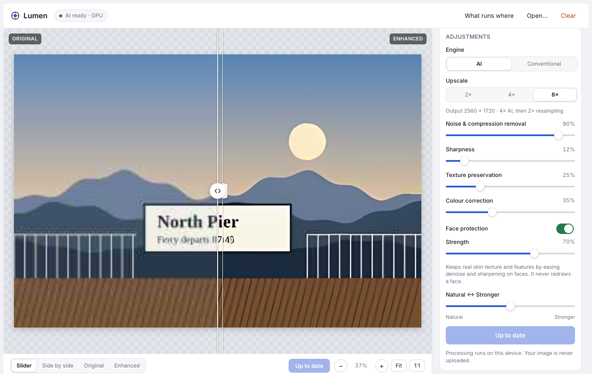
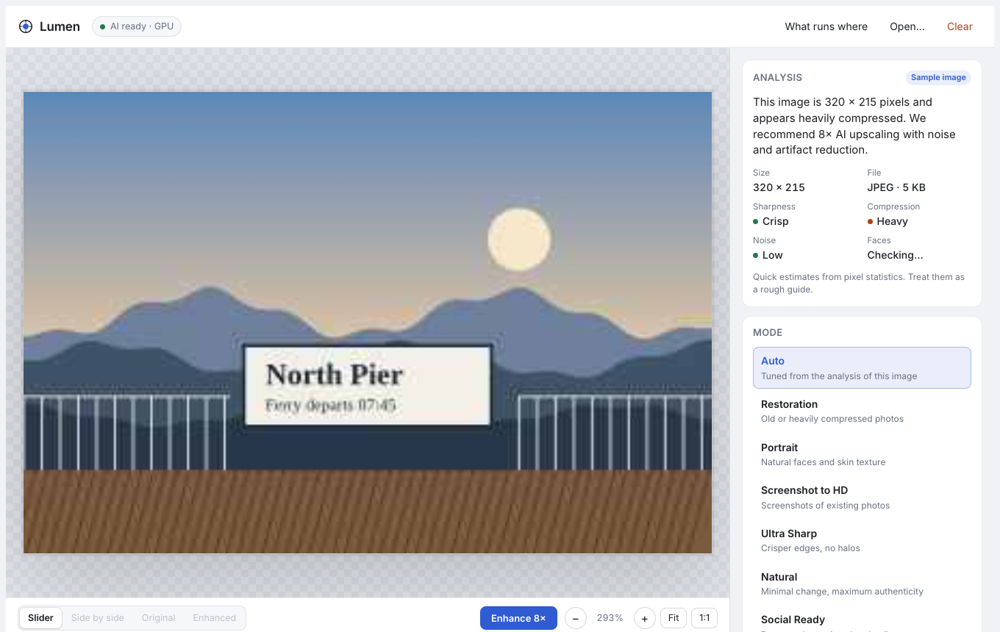
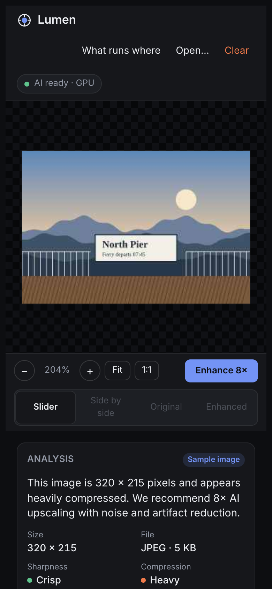

<div align="center">

# Lumen Photo Enhancer

**Turn blurry screenshots, compressed Instagram saves and soft video frames into sharper, higher resolution photos.**
Real AI super resolution (Real-ESRGAN) running privately in your browser, with an optional server for the bigger models.




</div>

## Why

Screenshots of photos, cropped faces and saved social media images are small, blocky and soft. Most "AI enhancer" demos either upload your photo to someone else's server or quietly apply a sharpen filter and call it AI. Lumen does neither:

* The neural network actually runs on your device. Your image never leaves it.
* Every step is labelled honestly. AI reconstruction is called AI; resampling, colour and sharpening are called what they are.
* Faces are protected, not redrawn. No beauty filter, no identity drift.

## Features

| | |
|---|---|
| **AI super resolution** | Real-ESRGAN general v3 on your GPU through TensorFlow.js. 2× and 4× are fully AI; 8× is 4× AI plus 2× resampling. |
| **Artifact and noise removal** | Removes JPEG blocking, ringing and grain. The strength slider blends Real-ESRGAN's two official checkpoints. |
| **Face protection** | Detects faces and gives them gentler denoising, less sharpening and more original texture, so skin and features stay real. |
| **Image analysis** | Reports size, format, sharpness, compression, noise and faces, then recommends a scale in one plain sentence. |
| **Seven modes** | Auto, Restoration, Portrait, Screenshot to HD, Ultra Sharp, Natural and Social Ready. |
| **Fine control** | Upscale factor, denoise, sharpness, texture preservation, colour correction, face protection and natural to stronger. |
| **Compare properly** | Draggable slider, side by side, original or enhanced, pinch and wheel zoom, pan, fit and true 1:1 pixel view. |
| **Export** | PNG, JPEG or WebP, quality control, sizes from full down to 1080 px, real file size shown. No watermark. |
| **Works everywhere** | iPhone, iPad and desktop, light and dark mode, reduced motion respected. |
| **Optional server** | Adds the larger Real-ESRGAN x4plus model and opt-in GFPGAN face restoration. |

<div align="center">

&nbsp;

</div>

## How to use

1. **Open a photo.** Drag it onto the window, paste it with Ctrl or Cmd + V, or press **Open**. PNG, JPEG and WebP up to 25 MB and 12 megapixels.
2. **Read the analysis.** Lumen tells you how soft, compressed and noisy the image looks and which upscale it recommends. These are rough estimates, not lab measurements.
3. **Pick a mode.** **Auto** is tuned from the analysis. Use **Screenshot to HD** for screenshots of photos, **Portrait** when a face matters, **Natural** for minimal change.
4. **Adjust if you like.** Every slider has a sensible default. Leave **Engine** on **AI** unless your device has no GPU support.
5. **Press Enhance.** Progress shows real tile counts, not an invented percentage. Press **Cancel** at any time.
6. **Compare.** Drag the slider, switch to **Side by side**, and press **1:1** to inspect actual pixels. Double click toggles between fit and 1:1.
7. **Tweak and apply.** After the first run, colour, sharpness and texture changes apply in about a second because the AI result is cached.
8. **Export.** Choose format, quality and size, check the file size, then **Download**.
9. **Clear.** Removes the image, the result and every cached buffer from memory.

### Tips for the best result

* Start from the largest version of the image you have. AI adds plausible detail; it cannot recover information that was never captured.
* Heavily compressed images: raise **Noise and compression removal** to 80 to 100%.
* Faces look too smooth: raise **Texture preservation** or lower denoise.
* Strong motion blur is beyond these models. Mild softness improves; heavy blur does not.

## Run it yourself

### Browser app only

Requires Node 18 or newer.

```sh
git clone https://github.com/shaaz1000/lumen-photo-enhancer.git
cd lumen-photo-enhancer
npm ci
npm run build        # writes dist/index.html and dist/models/
npx serve dist       # or any static file server
```

Open the printed URL. The converted model weights (2.4 MB each) are already in `public/models/`.

### With the enhancement server

Requires Python 3.10 or newer. No PyTorch needed for Real-ESRGAN.

```sh
npm ci && npm run build
cd backend
pip install -r requirements.txt            # use onnxruntime-gpu on NVIDIA machines
sh scripts/download_weights.sh             # add --faces for GFPGAN
cp -r ../dist static
uvicorn app.main:app --port 8000
```

Open http://localhost:8000. The app finds the server automatically and adds a **Server** engine.

Docker, from the repo root:

```sh
docker build -f backend/Dockerfile -t lumen .
docker run -p 8000:8000 lumen
```

### Server settings

| Variable | Default | Meaning |
|---|---|---|
| `ENHANCER_MAX_UPLOAD_MB` | 25 | Upload size limit |
| `ENHANCER_MAX_INPUT_MP` | 4 | Input megapixel limit |
| `ENHANCER_MAX_OUTPUT_MP` | 36 | Output megapixel limit |
| `ENHANCER_RATE_PER_MINUTE` | 6 | Requests per minute per client |
| `ENHANCER_RATE_BURST` | 3 | Burst allowance |
| `ENHANCER_MAX_CONCURRENT` | 2 | Parallel jobs; extra requests get HTTP 503 |
| `ENHANCER_TRUST_PROXY` | 0 | Read `X-Forwarded-For` (only behind your own proxy) |
| `ENHANCER_GFPGAN` | 1 | Load GFPGAN when its weights and package exist |
| `ENHANCER_PROVIDER` | local | `local`, or `replicate` with `REPLICATE_API_TOKEN` and `REPLICATE_MODEL_VERSION` (the key stays on the server) |

### API

`GET /api/health` returns the loaded model and whether face restoration is available.

`POST /api/enhance` takes `multipart/form-data`:

| Field | Type | Notes |
|---|---|---|
| `image` | file | PNG, JPEG or WebP |
| `scale` | 2 or 4 | default 4 |
| `denoise` | 0 to 1 | 0.5 or more uses x4plus when installed |
| `face_restore` | 0 to 1 | 0 disables GFPGAN (default) |

Returns `image/png`. Errors return JSON `{"detail": "..."}` with status 400, 413, 415, 422, 429, 503 or 504.

```sh
curl -F image=@photo.jpg -F scale=4 -F denoise=0.7 http://localhost:8000/api/enhance -o photo-4x.png
```

## What runs where

| Capability | Browser | Server |
|---|---|---|
| Real-ESRGAN general v3 (1.2 M params) | Yes, WebGL | Yes |
| Real-ESRGAN x4plus (16.7 M params) | No, too heavy | Yes |
| JPEG and noise removal | Yes | Yes |
| Face detection | Yes, 190 KB tiny detector | n/a |
| Identity preserving face handling | Yes | Yes |
| GFPGAN generative face restoration | No | Opt in, blended at most 60% |
| Conventional fallback (bicubic, bilateral, sharpen) | Yes, labelled "not AI" | n/a |

When published as a Claude artifact, the page cannot reach outside servers, so the server ships its own copy of the same app instead of the artifact calling it.

## How it works

```
photo ─► validate (file signature, size, dimensions)
      ─► analyse (blur, JPEG grid, noise, faces)
      ─► Real-ESRGAN, tiled with 24 px overlap ──► face regions re-run with gentler denoise
      ─► finishing: texture blend ─► colour (bounded) ─► halo-free sharpen
      ─► compare ─► export
```

* **Model in the browser.** The SRVGGNetCompact network is written directly with TensorFlow.js ops. `tools/convert_weights.py` turns the official `.pth` files into fp16 binaries using only NumPy, transposing kernels and reordering the last layer so `tf.depthToSpace` matches `torch.pixel_shuffle`.
* **Proved, not assumed.** `tests/srvgg.test.ts` checks the browser network against a NumPy port of the PyTorch model (max error under 0.001). The server's ONNX graphs pass the same check.
* **Seamless tiles.** 24 px of overlap makes tiled output match whole image output within one 8-bit level.
* **No halos.** Sharpening clamps each pixel to its local 3×3 range, so edges get crisper without bright or dark outlines.
* **Server without PyTorch.** The server unpickles checkpoints with a loader that refuses anything but tensors, builds ONNX graphs in memory and runs them with ONNX Runtime on CPU, CUDA or CoreML.

### Model choices

* **Real-ESRGAN general v3.** Small enough for phones, trained on realistic degradations, and not generative about faces.
* **Real-ESRGAN x4plus.** Stronger on photos but 64 MB and much slower, so server only.
* **SwinIR** was considered; it is larger and slower for similar results here and awkward in TensorFlow.js.
* **GFPGAN** is optional because generative face restoration can change how someone looks.
* **CodeFormer** is excluded because its licence forbids commercial use.

## Privacy

* In the browser, nothing is uploaded. No analytics, cookies or tracking.
* The server processes images in memory only: never written to disk, never logged, `Cache-Control: no-store` on every response.
* The server validates by file signature, guards against decompression bombs, caps pixels, rate limits per client and limits concurrency.

## Testing

```sh
npm test                    # 42 frontend tests
npm run typecheck
cd backend && pytest -q     # 15 backend tests
CHROME=/path/to/chrome npm run test:e2e -- photo.jpg   # headless browser run with screenshots
```

| Area | Covered by |
|---|---|
| Model correctness | Browser and ONNX networks against a NumPy reference; tiled vs whole image |
| Screenshots, compressed JPEGs, blur, noise | Analysis tests on synthetic degradations |
| Faces, multiple faces, no faces | Face mask and region tests; e2e with a group photo |
| Large, unsupported, corrupt and disguised files | Validation tests in browser and server |
| Extreme aspect ratios | Tiling and validation tests |
| Failed inference | Pipeline failure test; server JSON errors |
| Export and slider accuracy | Export size and slider geometry tests; e2e drag to 25% |
| Mobile | e2e phone layout in dark mode, no horizontal scroll |

The e2e run saves desktop and phone screenshots to `tests/e2e/out/` for visual regression checks.

## Project layout

```
src/engine/    model, tiling, pipeline, analysis, image ops, presets, validation, I/O
src/ui/        React app, viewer, geometry, sample image, save, styles
public/models/ converted Real-ESRGAN weights
backend/app/   FastAPI server, ONNX engine, graph builders, upload guard
tools/         weight converter, reference model, fixture generator
tests/         unit, model parity and e2e tests
```

## Limitations

* AI upscaling invents plausible detail. Do not use results as evidence or for identification.
* Strong motion blur and severe out of focus blur are not fixed.
* Phones handle up to about 16.7 megapixels of output, the iOS canvas limit.
* First load downloads about 5 MB of model weights.

## Changelog

See [CHANGELOG.md](CHANGELOG.md).

## Licence and credits

Code is MIT licensed, see [LICENSE](LICENSE).

* Real-ESRGAN models by Xintao Wang et al., BSD 3-Clause. [Paper](https://arxiv.org/abs/2107.10833), [repo](https://github.com/xinntao/Real-ESRGAN)
* Tiny face detector weights via [@vladmandic/face-api](https://github.com/vladmandic/face-api), MIT
* [TensorFlow.js](https://github.com/tensorflow/tfjs), Apache 2.0
* [GFPGAN](https://github.com/TencentARC/GFPGAN), Apache 2.0, optional

Built by [Shaaz Khan](https://github.com/shaaz1000).
